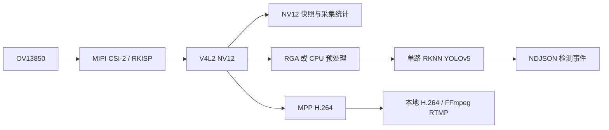

# 正点原子 RK3568 + OV13850 巡检机器人

第一次阅读可从 [开始学习](开始学习.md) 的采集示例入手。

**OV13850 驱动移植交付**见 [ATK-DLRK3568 驱动和板级设备树](kernel/port/README.md)。

以 ATK-DLRK3568 和正点原子 OV13850 为目标，将原工程的视觉链路移植到 RK3568。默认从 **V4L2 采集验证**开始，单路 RKNN 检测、RGA 预处理、MPP H.264 和 RTMP 可按需构建。ROS1 的 A*、全向 DWA 和麦克纳姆 CAN 设计保存在 [navigation](navigation)。

要练习内核驱动移植，从 [OV13850 驱动移植练习](kernel/README.md) 开始。目录里有基于厂商 SDK 生成练习驱动补丁的脚本，以及按你的板子实测节点编写的设备树 overlay。



## 1. 第一次上板

断电接好摄像头并确认排线方向。使用支持 OV13850 的正点原子 Linux 镜像，在厂商相机应用里预览一次后退出，再将本目录完整复制到板子。目标系统是 AArch64 Linux。正点原子说明书的预览命令以其他配套传感器为例，工程根据板上媒体拓扑选择设备。
[正点原子摄像头测试](https://wiki.alientek.com/docs/Boards/Linux/CLRK3568F/DLRK3568%20%E5%BF%AB%E9%80%9F%E4%BD%93%E9%AA%8C%E6%89%8B%E5%86%8C/function%20test/3.6/)

在板子的 Debian 或 Ubuntu 环境可安装 `g++`、`cmake`、`make`、`linux-libc-dev` 和 `v4l-utils`。工程要求 CMake 3.16+ 和支持 C++17 的编译器，例如 GCC 9+。Buildroot 用匹配镜像的 SDK 工具链交叉编译，见 [上板指南](docs/上板和验收.md)。

```bash
sh scripts/probe_camera.sh
cmake -S . -B build -DCMAKE_BUILD_TYPE=Release
cmake --build build -j2
(cd build && ctest --output-on-failure)
./build/inspection_robot config/robot.conf
```

默认请求 1280×720、30 FPS，采 120 帧后退出，第 30 帧写到 `frame.nv12`。程序打印协商尺寸、stride 和测得的帧率。复制快照到电脑后，用日志中的**实际尺寸**预览。

```bash
ffplay -f rawvideo -pixel_format nv12 -video_size 1280x720 frame.nv12
```

如果发现多个 `rkisp_mainpath`，通过 `media-ctl -p` 找到连接到 OV13850 的 ISP 输出，把 [配置文件](config/robot.conf) 的 `video_device` 改为对应的 `/dev/videoN`。每次运行都会覆盖同名快照文件。配置路径和输出路径基于执行程序时的工作目录。

手头这块板已用 `v4l2-ctl` 在 `/dev/video0` 验证 720p NV12。板上没有 CMake 和 g++ 时，可将生成的 `out/inspection_robot_aarch64` 和 `config/robot.conf` 一起传到板上用户目录，用 `chmod +x inspection_robot_aarch64` 和 `./inspection_robot_aarch64 robot.conf` 运行采集验证。这个预编译版本包含采集和快照。

## 2. 打开检测、编码与推流

从与板上内核驱动匹配的 RK3568 SDK 取得三套头文件和运行库。RKNN 用 RKNN-Toolkit2 导出的 `rk3568` 模型，RGA 用 RK356x 对应版本，编码用 Rockchip MPP。开启某个组件后，如 CMake 无法自动找到它，使用表中的变量给出绝对路径。

| 功能 | CMake 开关 | 头文件目录与运行库 |
| --- | --- | --- |
| 单路 RKNN | `ROBOT_WITH_RKNN=ON` | `RKNN_INCLUDE_DIR`、`RKNN_LIBRARY` |
| RGA | `ROBOT_WITH_RGA=ON` | `RGA_INCLUDE_DIR`、`RGA_LIBRARY` |
| MPP + RTMP | `ROBOT_WITH_MPP=ON` | `MPP_INCLUDE_DIR`、`MPP_LIBRARY` |

```bash
cmake -S . -B build-full -DCMAKE_BUILD_TYPE=Release \
  -DROBOT_WITH_RKNN=ON -DROBOT_WITH_RGA=ON -DROBOT_WITH_MPP=ON
cmake --build build-full -j2
```

**检测。** 在装有 RKNN-Toolkit2 的 Linux 主机上，使用瑞芯微 Model Zoo 的 YOLOv5 示例和 `yolov5s_relu.onnx`。示例提供下载入口，转换脚本使用示例自带的 COCO 校准集，输出到项目的 `model/yolov5s_rk3568.rknn`。
[Rockchip YOLOv5 示例](https://github.com/airockchip/rknn_model_zoo/tree/main/examples/yolov5)

```bash
sh scripts/convert_yolov5.sh /path/to/rknn_model_zoo /path/to/yolov5s_relu.onnx
```

将生成的模型复制到板上工程的 `model/` 并在配置中设置 `model=model/yolov5s_rk3568.rknn`。先确认 CPU 预处理可用，再设置 `use_rga=true` 联调。事件文件 `inspection_events.ndjson` 按行记录时间、V4L2 序号、类别、置信度和原图坐标。COCO 标签用于跑通通用物体检测，矿山缺陷需要对应的训练模型和标签。当前解码器适用 Model Zoo 的 640×640 YOLOv5 三尺度输出和默认 anchor。

**编码和推流。** 在自己的配置中设置 `h264_file=inspection.h264` 先验证本地文件，用 `ffplay -f h264 inspection.h264` 播放。持续推流时设 `frames=0`，清空 `snapshot`，再把 `rtmp_url` 填成已运行服务的发布地址并安装带 RTMP 支持的 FFmpeg。`Ctrl+C` 会关闭采集和工作线程。RTMP 地址建议放在本地配置中。

## 3. 代码阅读顺序

1. [main.cpp](src/main.cpp) 从采集循环和线程启动看一帧如何分流。
2. [capture.cpp](src/capture.cpp) 跟踪 `S_FMT → REQBUFS → QBUF → STREAMON → DQBUF`，关注缓冲区何时归还。
3. [nv12.cpp](src/nv12.cpp)、[detector.cpp](src/detector.cpp)、[yolo.cpp](src/yolo.cpp) 跟踪 NV12、RGB、模型张量和检测框。
4. [encoder.cpp](src/encoder.cpp)、[rtmp.cpp](src/rtmp.cpp) 跟踪 NV12 如何进入编码器，以及断线后如何从 IDR 恢复。

板卡排错、运行库检查和分阶段验收见 [上板指南](docs/上板和验收.md)。
